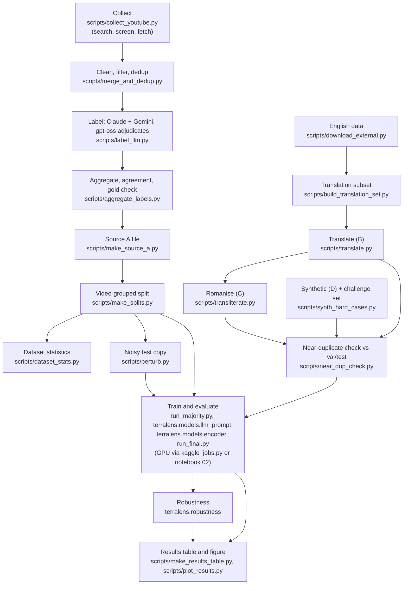
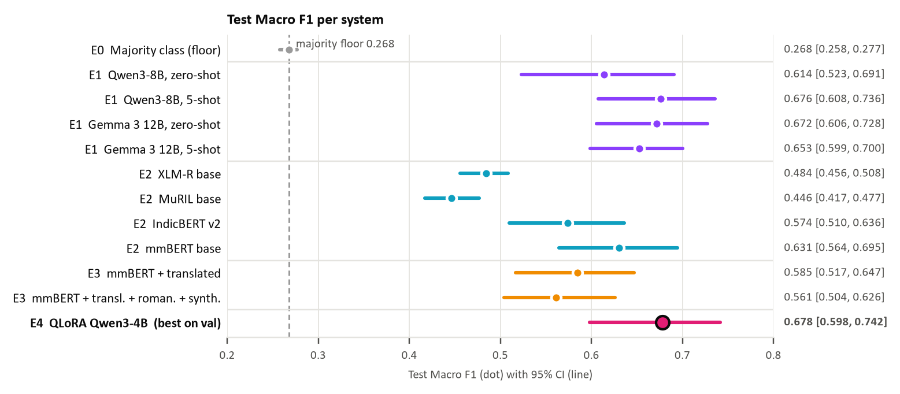

# TerraLens

**Stance detection on Hindi and Bengali YouTube comments about climate change.**

**Live demo:** [DEMO.md](DEMO.md) runs the dataset summary, a tiny CPU training run, the results table and the
tests on a laptop CPU in about half a minute (`scripts/demo.ps1` on Windows, `scripts/demo.sh` elsewhere).

TerraLens is a course project for **CSET 346 (Natural Language Processing), Bennett University**. Given a
YouTube comment in Hindi or Bengali (native script, romanised, or code-mixed with English), the task is to
classify its stance toward the claim **"Climate change and global warming is a serious concern."** as
**Favour** (supports the claim), **Against** (denies or dismisses it) or **None** (no stance: off-topic,
neutral, questions, spam). The comments are short, noisy and multi-script, and Against is rare (100 of 3,825
comments), so the primary metric is **Macro F1**, with **Against F1** always reported next to it. We compare a
majority floor, prompted open LLMs, four fine-tuned multilingual encoders, the best encoder with extra
training data, and a QLoRA-fine-tuned 4B LLM, all on the same video-grouped splits.

Every number in this README comes from a file in `results/` (via `reports/results.md` and
`reports/dataset_stats.md`, which are generated from those files).

## Dataset

Only **Source A** (real YouTube comments) is used for validation and test. Sources B, C and D are
training-only, and the challenge set and noisy test copy are evaluation-only.

| Source | What it is | Rows | Favour / Against / None | Used for |
|---|---|---:|---|---|
| **A** YouTube comments | Hindi and Bengali comments from 64 climate videos, labelled by LLM annotators (see below) | 3,825 | 814 / 100 / 2,911 | train, val, test |
| &nbsp;&nbsp;Hindi | | 2,377 | 637 / 66 / 1,674 | |
| &nbsp;&nbsp;Bengali | | 1,448 | 177 / 34 / 1,237 | |
| **B** translated | English stance data translated with IndicTrans2, each sentence into one language | 7,991 | hi 895 / 2,138 / 962; bn 902 / 2,158 / 936 | train only |
| **C** romanised | rule-based romanised copies of native-script train rows and of B | 3,053 | not recorded | train only |
| **D** synthetic | Gemini-generated hard comments kept where Claude and Gemini agree (470 of 600) | 470 | 106 / 177 / 187 | train only |
| Challenge set | Gemini-generated negation, sarcasm, implicit and topic-not-target comments (217 of 300 kept) | 217 | 58 / 55 / 104 | evaluation only |
| Noisy test | test with character noise and transliteration | 538 | same as test | evaluation only |

English data behind Source B (`results/external_datasets.json`): Kaggle Twitter climate sentiment (38,488
rows), ClimateStance Reddit (6,208, Against only used), GWSD (2,050), SemEval-2016 climate (564) and the
ClimateStance gold set (303). Mojibake was repaired with ftfy in 6,184 of 6,203 affected Kaggle rows.
A near-duplicate check (char 3–5-gram TF-IDF, cosine > 0.9) against val, test, the noisy test and the
challenge set dropped 0 rows from B, C and D (`results/near_dup_check.json`).

**Script mix of Source A.** Hindi: 900 Devanagari, 1,404 Latin, 73 mixed. Bengali: 1,106 Bengali script,
306 Latin, 36 mixed. Median length 14 (Hindi) and 9 (Bengali) whitespace tokens.

**Splits.** Grouped by video (all comments of a video are in one split) with StratifiedGroupKFold on
label × language, seed 43: the first of seeds 42–61 with at least 12 Against comments and both languages in
validation and test (`results/splits.json`). The split files in `data/splits/` are fixed and used by every
model.

| Split | Videos | Comments | Favour | Against | None | Hindi / Bengali |
|---|---:|---:|---:|---:|---:|---|
| train | 43 | 2,765 | 584 | 60 | 2,121 | 1,693 / 1,072 |
| val | 11 | 522 | 74 | 19 | 429 | 357 / 165 |
| test | 10 | 538 | 156 | 21 | 361 | 327 / 211 |

## How the labels were made

1. **Collection and cleaning.** 6,224 comments were collected from 64 videos. Cleaning removed
   10 empty, 354 emoji-only, 1,264 English, 493 other-language and 236 too-short comments, plus 60 exact and
   9 near duplicates, leaving 3,798 (`results/comment_cleaning.json`). 183 comments whose language was
   uncertain were also sent for labelling; 58 were kept because at least two annotators said Hindi or Bengali.
2. **Two full annotators.** Claude (a separate Claude Code session, Sonnet) and Gemini
   (gemini-3.5-flash-lite) labelled every one of the 3,981 items with the same guideline
   (`annotation/guidelines.md`). On the 3,856 kept items they agree on 88.72%, **Cohen's kappa 0.7173**
   (Hindi 0.6994, Bengali 0.735).
3. **Adjudication.** The 435 disagreements went to **gpt-oss-120b** (on Groq). Where it matched one of the two
   labels (404 cases), that label was used. The **31 three-way splits were dropped**.
4. **Three-annotator check.** Fleiss' kappa of Claude, Gemini and gpt-oss on a 300-comment sample is 0.784
   (n = 294). The sample was drawn from comments where Claude and Gemini already agreed, so this is biased
   upward.
5. **Gold check.** The annotators also labelled 303 human-labelled English ClimateStance Reddit comments and
   100-comment Hindi and Bengali translations of them (`results/llm_gold_check.json`):

   | Annotator | English (n = 303) Macro F1 | Hindi translation (n = 100) | Bengali translation (n = 100) |
   |---|---:|---:|---:|
   | Claude | 0.637 | 0.695 | not scored: its Bengali labels equal its Hindi labels |
   | Gemini | 0.641 | 0.709 | 0.672 |
   | gpt-oss-120b | 0.608 | not labelled | not labelled |

   ClimateStance calls opposition to climate policy Against and treats sarcasm as ambiguous; our guideline
   labels policy opposition None and sarcasm by its meaning, so these scores slightly understate agreement
   with our guideline.

None of the annotator models (Claude, Gemini, gpt-oss) is used as a baseline.

## Pipeline



A step-by-step list of every script with its input and output files is in
[docs/CODE_FLOW.md](docs/CODE_FLOW.md).

## Models

| Exp | Model | Why it was chosen |
|---|---|---|
| E0 | Majority class (always None) | A floor: any useful model must beat it. |
| E1 | Qwen3-8B, 4-bit, zero-shot and 5-shot | Open multilingual instruction model that fits a T4 in 4-bit; not one of the annotators. |
| E1 | Gemma 3 12B, 4-bit, zero-shot and 5-shot | A larger multilingual instruction model that still fits a T4 in 4-bit (ungated mirror `unsloth/gemma-3-12b-it-bnb-4bit`). |
| E2 | XLM-R base | The standard multilingual encoder baseline. |
| E2 | MuRIL base | Pre-trained on Indian languages including transliterated text, which suits romanised comments. |
| E2 | IndicBERT v2 | Pre-trained on Indic-language corpora, including Hindi and Bengali. |
| E2 | mmBERT base | A recent ModernBERT-style encoder pre-trained on a much wider set of languages. |
| E3 | Best E2 encoder (mmBERT) + B, and + B + C + D | Tests whether translated, romanised and synthetic training data help the best encoder. |
| E4 | QLoRA on Qwen3-4B as a 3-way classifier, on the E3 data | Fine-tunes an LLM within T4 memory (4-bit base, LoRA r = 16). |

Encoders are trained as (claim, comment) sentence pairs: max length 128, lr 2e-5, batch 32, 4 epochs, 10%
warm-up, fp16, class-weighted cross-entropy, early stopping on validation Macro F1, seed 42. E4 uses lr 2e-4,
batch 8 × 4 accumulation, max length 160, 1 epoch, on 14,279 training rows (2,765 YouTube, 7,991 translated,
3,053 romanised, 470 synthetic). For every fine-tuned model, per-class logit offsets are also tuned on
validation, and test is reported with and without them (see `reports/results.md`). Epochs, offsets and the
best model are chosen on **validation only**; test is scored once per configuration.

## Results

Validation has 522 comments (19 Against) and test has 538 (21 Against). 95% CIs come from 1,000 bootstrap
resamples of the test comments. Full tables, including per-script scores and tuned offsets, are in
[reports/results.md](reports/results.md).

| Exp | System | Val Macro F1 | Test Macro F1 [95% CI] | Test Against F1 [95% CI] | Test acc. |
|---|---|---:|---:|---:|---:|
| E0 | Majority class (floor) | 0.301 | 0.268 [0.258, 0.277] | 0.000 [0.000, 0.000] | 0.671 |
| E1 | Qwen3-8B, zero-shot | 0.549 | 0.614 [0.523, 0.691] | 0.385 [0.125, 0.609] | 0.788 |
| E1 | Qwen3-8B, 5-shot | 0.525 | 0.676 [0.608, 0.736] | 0.510 [0.324, 0.667] | 0.797 |
| E1 | Gemma 3 12B, zero-shot | 0.583 | 0.672 [0.606, 0.728] | 0.423 [0.246, 0.562] | 0.810 |
| E1 | Gemma 3 12B, 5-shot | 0.545 | 0.653 [0.599, 0.700] | 0.410 [0.265, 0.522] | 0.756 |
| E2 | XLM-R base | 0.471 | 0.484 [0.456, 0.508] | 0.000 [0.000, 0.000] | 0.749 |
| E2 | MuRIL base | 0.512 | 0.446 [0.417, 0.477] | 0.000 [0.000, 0.000] | 0.749 |
| E2 | IndicBERT v2 | 0.605 | 0.574 [0.510, 0.636] | 0.238 [0.062, 0.415] | 0.764 |
| E2 | mmBERT base | 0.661 | 0.631 [0.564, 0.695] | 0.318 [0.128, 0.489] | 0.805 |
| E3 | mmBERT + translated | 0.661 | 0.585 [0.517, 0.647] | 0.200 [0.000, 0.375] | 0.803 |
| E3 | mmBERT + translated + romanised + synthetic | 0.674 | 0.561 [0.504, 0.626] | 0.143 [0.000, 0.320] | 0.803 |
| **E4** | **QLoRA Qwen3-4B** (best on validation) | **0.687** | **0.678 [0.598, 0.742]** | 0.419 [0.210, 0.583] | **0.818** |



*Built by `scripts/plot_results.py` from `results/*.json`. The ringed dot is the system chosen on validation.*

**Best model (E4) on test.** Per class (precision / recall / F1): Favour 0.742 / 0.737 / 0.740 (156),
Against 0.409 / 0.429 / 0.419 (21), None 0.875 / 0.875 / 0.875 (361). Macro F1 per language: Hindi 0.644,
Bengali 0.736 (Bengali test has only 4 Against comments).

| Gold \ Predicted | Favour | Against | None |
|---|---:|---:|---:|
| Favour | 115 | 6 | 35 |
| Against | 2 | 9 | 10 |
| None | 38 | 7 | 316 |

**Seed variance** (seeds 42, 43, 44):

| Config | Val Macro F1 | Test Macro F1 | Test Against F1 |
|---|---|---|---|
| E2 mmBERT | 0.628 ± 0.028 | 0.630 ± 0.023 | 0.320 ± 0.091 |
| E3 mmBERT + B + C + D | 0.665 ± 0.037 | 0.587 ± 0.024 | 0.202 ± 0.053 |

**Robustness.** On a noisy copy of test, E3 (3 seeds) drops 0.005 ± 0.005 Macro F1 and E4 (one retrained run)
drops 0.009. On the 217-comment challenge set, E3 scores 0.757 ± 0.042, weakest on sarcasm (0.670) and
implicit stance (0.684), and E4 scores 0.825, weakest on implicit stance (0.704).

**What the results show.**
- E4 is best on validation and has the highest test Macro F1, though its CI overlaps those of the E1 models
  and E2 mmBERT.
- Among encoders, mmBERT is clearly best. XLM-R and MuRIL never predict Against with these settings
  (60 Against comments in train).
- The training-only data (B, C, D) raises validation scores but lowers test scores for every seed, so the
  validation gain does not carry over.
- The prompted LLMs (E1) are below the encoders on validation but above most of them on test. Validation has
  only 19 Against and 2 Bengali Favour comments, so selection on it is noisy; all choices were still made on
  validation.

## Limitations

- **LLM labels, no human labels on the YouTube data.** Claude–Gemini agreement is kappa 0.7173, and the
  annotators reach Macro F1 0.61–0.71 on the human gold set, which is English Reddit text with a slightly
  different definition of Against.
- **Against is very rare.** There are 100 Against comments (19 in validation, 21 in test, 4 in Bengali test),
  so Against F1 has wide CIs (E4: [0.210, 0.583]) and Bengali per-language scores are unstable.
- **Validation and test disagree** on which system is better (see above). The small validation set makes
  model selection noisy.
- **Few runs.** Most systems ran once with seed 42. E4 ran once, and its robustness numbers come from a
  retrained run that is not identical (val Macro F1 0.657 instead of 0.687; `results/e4_qlora_robust.json`).
- **Generated data.** Synthetic training comments and the challenge set were written by Gemini and kept only
  where Claude and Gemini agree (kappa 0.6728 and 0.5834), so they reflect what those models find clear.
- **Tooling choices.** Romanisation is rule-based. Gemma 3 and IndicTrans2 come from ungated mirrors
  (IndicTrans2 pinned to a reviewed commit).
- **Small scope.** 64 videos found by keyword search, and only one claim.

## Reproduce

Python 3.10+. CPU steps run on a laptop; GPU steps need one T4 (Kaggle or Colab).
For a quick check without data or a GPU, run the [live demo](DEMO.md) first.

```bash
python -m venv .venv && source .venv/bin/activate     # Windows: .venv\Scripts\activate
pip install -r requirements.txt && pip install -e .   # GPU machine: pip install -r requirements-gpu.txt
pytest
```

API keys go in a git-ignored `.env`: `YOUTUBE_API_KEY`, `GEMINI_API_KEY`, `GROQ_API_KEY`, and
`KAGGLE_USERNAME` + `KAGGLE_API_TOKEN` for Kaggle runs. Every script has `--help` and a `--limit N` dry run.

```bash
# 1. Source A: collect, clean, label, aggregate, split
python scripts/collect_youtube.py search
python scripts/collect_youtube.py screen
python scripts/collect_youtube.py fetch
python scripts/merge_and_dedup.py
python scripts/label_llm.py prepare
python scripts/label_llm.py run --annotator gemini --set gold
python scripts/label_llm.py run --annotator gemini --set main
#    Claude labels the same items in a separate Claude Code session (annotation/prompts/claude_session.md)
python scripts/label_llm.py validate --annotator claude
python scripts/label_llm.py adjudicate
python scripts/aggregate_labels.py
python scripts/make_source_a.py
python scripts/make_splits.py
python scripts/dataset_stats.py

# 2. Training-only and evaluation-only data
python scripts/download_external.py
python scripts/build_translation_set.py
python scripts/translate.py                       # GPU (trust_remote_code: run on Kaggle/Colab)
python scripts/transliterate.py
python scripts/synth_hard_cases.py generate --set synthetic --n 600
python scripts/synth_hard_cases.py generate --set challenge --n 300
python scripts/synth_hard_cases.py label --set synthetic
python scripts/synth_hard_cases.py label --set challenge
python scripts/write_claude_labels.py --set synthetic --file <claude labels>   # same for --set challenge
python scripts/synth_hard_cases.py finalise
python scripts/perturb.py
python scripts/near_dup_check.py

# 3. Experiments
python scripts/run_majority.py                                                  # E0, CPU
python scripts/make_data_zip.py                                                 # data bundle for Colab
python scripts/kaggle_jobs.py dataset                                           # or the private Kaggle dataset
#    on the GPU (notebooks/02_train_gpu_colab.ipynb, or kaggle_jobs.py push --cmd "...", then fetch):
python -m terralens.models.llm_prompt --config configs/e1_qwen3_8b_0shot.yaml   # and the other e1_*.yaml
python -m terralens.models.encoder --config configs/e2_mmbert.yaml              # and the other e2_*.yaml
python -m terralens.models.encoder --config configs/e3_best_plus_b.yaml
python -m terralens.models.encoder --config configs/e3_best_plus_bcd.yaml
python scripts/run_final.py --candidates configs/e2_xlmr.yaml configs/e2_muril.yaml configs/e2_indicbertv2.yaml \
    configs/e2_mmbert.yaml configs/e3_best_plus_b.yaml configs/e3_best_plus_bcd.yaml   # best by val + seeds + E4
python -m terralens.models.encoder --config configs/e2_mmbert.yaml --seed 43    # and --seed 44 (seed table)
python -m terralens.models.encoder --config configs/e4_qlora.yaml --exp-suffix _robust \
    --extra-eval challenge=data/challenge/challenge.csv test_noisy=data/processed/test_noisy.csv

# 4. Analysis and reports
python -m terralens.robustness results/e3_best_plus_bcd_robust.json results/e3_best_plus_bcd_s43.json \
    results/e3_best_plus_bcd_s44.json --out results/robustness_e3_best_plus_bcd.json
python -m terralens.robustness results/e4_qlora_robust.json --out results/robustness_e4_qlora.json
python scripts/error_analysis.py sample
python scripts/error_analysis.py notebook
python scripts/error_analysis.py summary
python scripts/make_results_table.py
python scripts/plot_results.py
python scripts/make_report_figures.py      # progress-report figures
python scripts/build_report.py             # reports/progress_report.pdf (2 A4 pages)
```

## Repository layout

```
terralens/
├── annotation/            labelling guideline and LLM prompts
├── configs/               one YAML per experiment (e1_*, e2_*, e3_*, e4_qlora) + youtube_search.yaml
├── data/
│   ├── raw/ interim/ external/ processed/   not committed (comment text, labels, generated data)
│   ├── splits/            fixed train/val/test id lists
│   └── challenge/         challenge set, not committed
├── docs/CODE_FLOW.md      every script and module: input -> what it does -> output
├── legacy/                early TF-IDF baseline code, kept for reference only (not in results)
├── notebooks/             01 dataset stats, 02 GPU training (Colab), 03 error analysis
├── reports/               results.md, dataset_stats.md, progress_report.md, figures/
├── results/               one JSON per experiment (config, seed, metrics, timestamp); predictions/ not committed
├── scripts/               pipeline scripts (see the flowchart above)
├── src/terralens/         package: preprocess, language, splits, evaluate, thresholds, reporting,
│                          robustness, models/encoder.py, models/llm_prompt.py
└── tests/                 pytest unit tests
```

## External data citations

- Saif M. Mohammad, Svetlana Kiritchenko, Parinaz Sobhani, Xiaodan Zhu and Colin Cherry. 2016.
  *SemEval-2016 Task 6: Detecting Stance in Tweets.* SemEval-2016. <https://aclanthology.org/S16-1003/>
- Francesco Barbieri, Jose Camacho-Collados, Luis Espinosa Anke and Leonardo Neves. 2020. *TweetEval:
  Unified Benchmark and Comparative Evaluation for Tweet Classification.* Findings of EMNLP 2020.
  <https://aclanthology.org/2020.findings-emnlp.148/>
- Yiwei Luo, Dallas Card and Dan Jurafsky. 2020. *Detecting Stance in Media on Global Warming.* Findings of
  EMNLP 2020. <https://aclanthology.org/2020.findings-emnlp.296/>
- ClimateStance / ClimateReddit (Vaid et al., 2022), GitHub `roopalv54/finegrained-climate-change-social-media`.
- Twitter Climate Change Sentiment Dataset (Qian), Kaggle `edqian/twitter-climate-change-sentiment-dataset`.

## License

[MIT](LICENSE)
