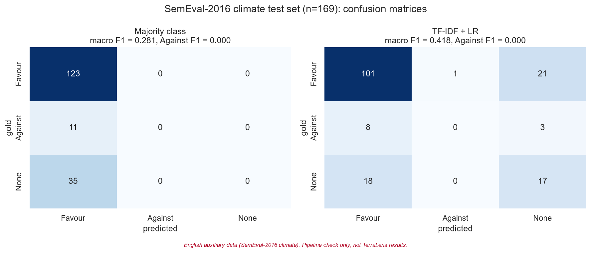
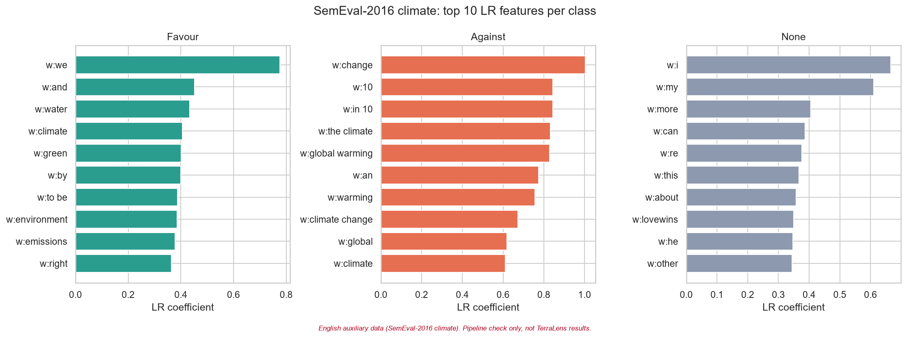

# LEGACY: SemEval-2016 climate TF-IDF + LR baseline

> **English auxiliary data (SemEval-2016 climate). Pipeline check only, not TerraLens results.**
> Legacy record of the early pipeline check. Classical models are not part of the TerraLens Milestone 2 results.
> Generated by `legacy/notebooks/semeval_tfidf_baseline.ipynb`. EDA of this data: `reports/eda_semeval.md`.

## Baseline (train+validation → test)

TF-IDF word 1-2-grams + char_wb 2-5-grams (`FeatureUnion`, `min_df=2`, sublinear TF) + `LogisticRegression(class_weight="balanced", max_iter=1000)`,
compared with a majority-class (`Favour`) baseline. Trained on 395 tweets, evaluated once on 169 test tweets.

| model | accuracy | macro_f1 | against_f1 |
|---|---|---|---|
| Majority class | 0.728 | 0.281 | 0.0 |
| TF-IDF + LR | 0.698 | 0.418 | 0.0 |

TF-IDF + LR per-class results on test:

| class | precision | recall | f1-score | support |
|---|---|---|---|---|
| Favour | 0.795 | 0.821 | 0.808 | 123 |
| Against | 0.0 | 0.0 | 0.0 | 11 |
| None | 0.415 | 0.486 | 0.447 | 35 |

**Against-class F1 (TF-IDF + LR): 0.000** (majority baseline: 0.000).

| gold | pred Favour | pred Against | pred None |
|---|---|---|---|
| Favour | 101 | 1 | 21 |
| Against | 8 | 0 | 3 |
| None | 18 | 0 | 17 |

Top LR features per class:

- Favour: w:we, w:and, w:water, w:climate, w:green, w:by, w:to be, w:environment, w:emissions, w:right
- Against: w:change, w:10, w:in 10, w:the climate, w:global warming, w:an, w:warming, w:climate change, w:global, w:climate
- None: w:i, w:my, w:more, w:can, w:re, w:this, w:about, w:lovewins, w:he, w:other

## Takeaways

- The preprocessing → TF-IDF → LR → evaluation pipeline ran end to end.
- LR beats the majority baseline on macro F1 (0.418 vs 0.281).
- Against F1 is 0.000: LR predicted Against 1 time(s) and recovered
  0 of 11 gold Against tweets. With only
  15 Against tweets in training, class weighting alone is not enough, and with
  11 in test a single prediction moves Against F1 a lot.

*English auxiliary data (SemEval-2016 climate). Pipeline check only, not TerraLens results.*
