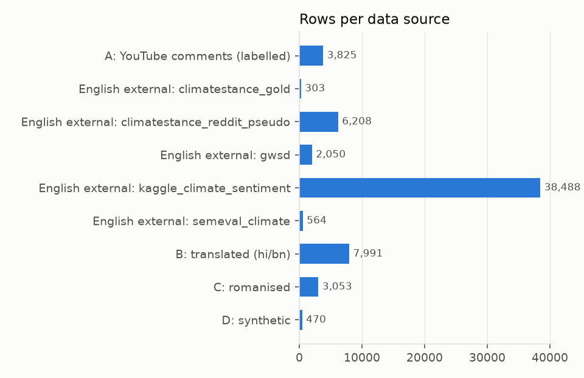
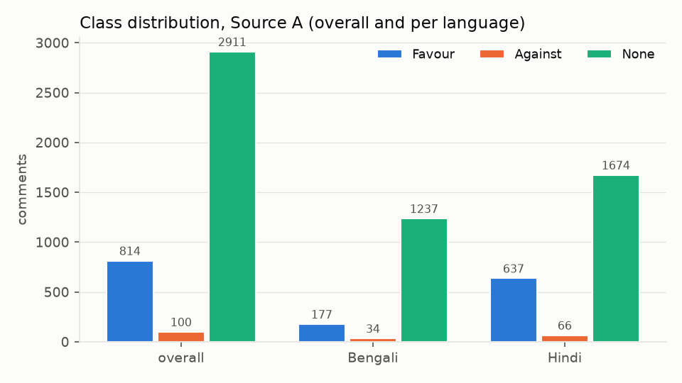
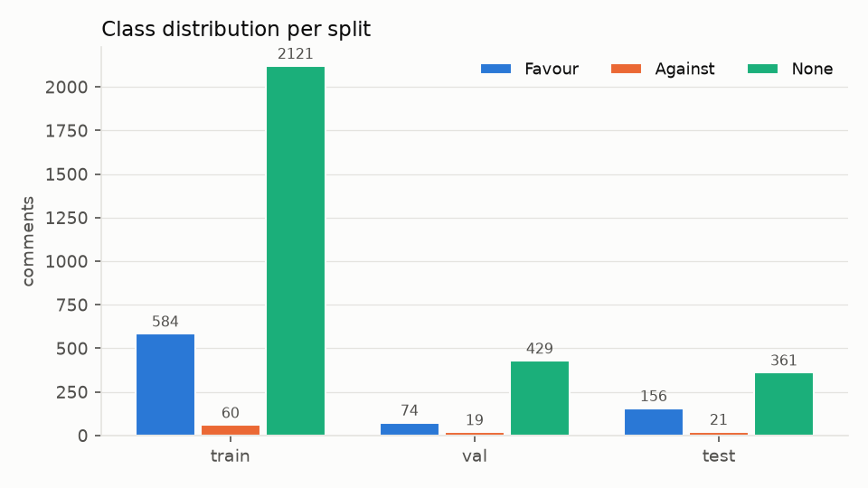
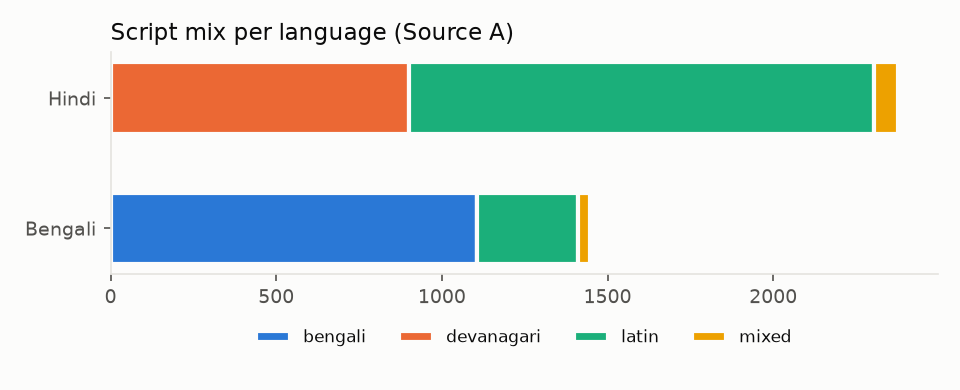
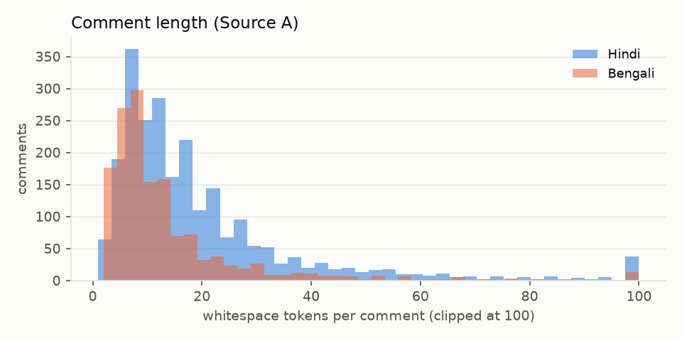

# Dataset statistics

Generated by `scripts/dataset_stats.py` at 2026-11-18T21:42:24+00:00; every number below is in `results/dataset_stats.json`.

## Sources

| Source | Rows |
|---|---:|
| A: YouTube comments (labelled) | 3,825 |
| English external: climatestance_gold | 303 |
| English external: climatestance_reddit_pseudo | 6,208 |
| English external: gwsd | 2,050 |
| English external: kaggle_climate_sentiment | 38,488 |
| English external: semeval_climate | 564 |
| B: translated (hi/bn) | 7,991 |
| C: romanised | 3,053 |
| D: synthetic | 470 |

Only Source A (real YouTube comments) is used for validation and test. English external data, translations (B), romanised text (C) and synthetic comments (D) are training-only; 0 means not built yet.

## Source A: 3,825 labelled comments from 64 videos

| Set | Favour | Against | None | Total |
|---|---:|---:|---:|---:|
| overall | 814 | 100 | 2,911 | 3,825 |
| Bengali | 177 | 34 | 1,237 | 1,448 |
| Hindi | 637 | 66 | 1,674 | 2,377 |

### Per split (grouped by video)

| Split | Favour | Against | None | Total |
|---|---:|---:|---:|---:|
| train | 584 | 60 | 2,121 | 2,765 |
| val | 74 | 19 | 429 | 522 |
| test | 156 | 21 | 361 | 538 |

Videos per split: test 10, train 43, val 11.

| Split / language | Favour | Against | None | Total |
|---|---:|---:|---:|---:|
| test/bn | 29 | 4 | 178 | 211 |
| test/hi | 127 | 17 | 183 | 327 |
| train/bn | 146 | 23 | 903 | 1,072 |
| train/hi | 438 | 37 | 1,218 | 1,693 |
| val/bn | 2 | 7 | 156 | 165 |
| val/hi | 72 | 12 | 273 | 357 |

### Script mix

| Language | bengali | devanagari | latin | mixed |
|---|---:|---:|---:|---:|
| Bengali | 1106 | 0 | 306 | 36 |
| Hindi | 0 | 900 | 1404 | 73 |

### Length (whitespace tokens)

- Bengali: mean 14.7, median 9.0, 95th percentile 41.0, max 474
- Hindi: mean 20.6, median 14.0, 95th percentile 57.0, max 730
- Share of comments over 128 whitespace tokens: 0.65% (subword length is larger; the encoders truncate at 128 subword tokens).

### Top words per class (stopwords removed)

- **Favour**: গাছ (65), आचार्य (61), जी (58), जलवायु (57), परिवर्तन (56), climate (51), सबसे (49), पेड़ (49), change (48), कम (47), बात (46), ज्यादा (45), नही (42), प्रकृति (41), इंसान (41)
- **Against**: change (12), এটা (11), বরফ (11), বেশি (10), global (9), মানুষ (8), warming (8), co (8), পৃথিবীর (7), ne (7), মিথ্যা (7), সেটা (7), কথা (7), climate (7), আগে (6)
- **None**: আল্লাহ (150), ভিডিও (137), sir (133), আমাদের (122), आचार्य (121), जी (115), nhi (114), ji (106), আপনার (103), অনেক (99), video (92), ভালো (90), ধন্যবাদ (82), করুন (80), india (77)

### Cleaning (from `results/comment_cleaning.json`)

| Step | Removed |
|---|---:|
| empty | 10 |
| emoji_only | 354 |
| english | 1,264 |
| other_language | 493 |
| too_short | 236 |
| exact_dup | 60 |
| near_dup | 9 |

## Label agreement (from `results/annotation_agreement.json`)

- Cohen's kappa, Claude vs Gemini: 0.7173 (n = 3856, 88.72% agreement).
- Per language: Bengali 0.735, Hindi 0.6994.
- Per script: bengali 0.7381, devanagari 0.7123, latin 0.6699, mixed 0.7559.
- Disagreements: 435; resolved by gpt-oss: 404; 3-way splits (dropped): 31.
- Fleiss' kappa (Claude, Gemini, gpt-oss) on the 300-comment sample: 0.784 (n = 294). The sample was drawn from comments where Claude and Gemini already agree, so this mostly measures gpt-oss against that consensus and is biased upward.

## Figures

