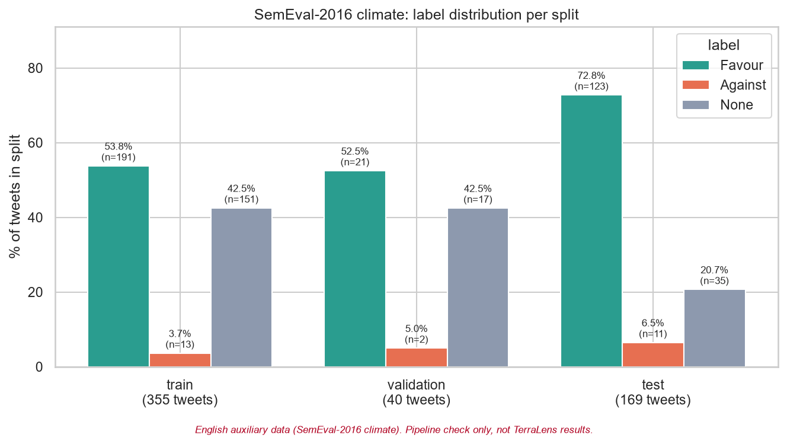
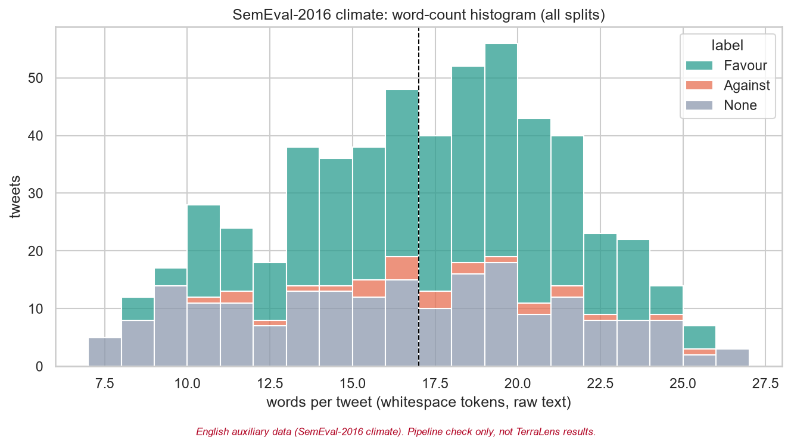
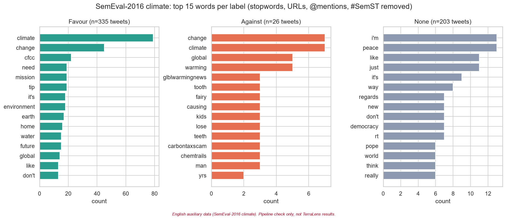

# SemEval-2016 climate: EDA summary

> **English auxiliary data (SemEval-2016 climate). Pipeline check only, not TerraLens results.**
> These are English tweets used as auxiliary data. Nothing here measures performance on the Hindi/Bengali
> TerraLens task. Generated by `notebooks/01_eda_semeval.ipynb`.

## Data

`data/external/semeval_climate.csv`: 564 English tweets on the target *"Climate Change is a Real Concern"*
(SemEval-2016 Task 6, via `cardiffnlp/tweet_eval` `stance_climate`).

| split | Favour | Against | None | total |
|---|---|---|---|---|
| train | 191 | 13 | 151 | 355 |
| validation | 21 | 2 | 17 | 40 |
| test | 123 | 11 | 35 | 169 |
| total | 335 | 26 | 203 | 564 |

- **Against is tiny**: 26 tweets overall (4.6%),
  and only 11 in test, so Against-class metrics on this set
  would be very noisy.
- Tweets are short: median 17 words, mean 16.6.

| label | count | mean | median | min | max |
|---|---|---|---|---|---|
| Favour | 335 | 17.01 | 17.0 | 8 | 25 |
| Against | 26 | 16.88 | 16.5 | 10 | 25 |
| None | 203 | 15.88 | 16.0 | 7 | 27 |

**Noise.** 564 tweets (100.0%) carry the `#SemST`
collection tag; 71.3% have another hashtag,
40.2% an @mention, 0.0% a URL and
0.0% an emoji. The `tweet_eval` release is already pre-processed: user handles are
masked as `@user`, and URLs and emojis were stripped upstream, so the URL/emoji cleaning steps are not exercised here
(the YouTube comments will need them).

**Top words** (stopwords, URLs, @mentions, `#SemST` removed):

- Favour: climate (79), change (45), cfcc (22), need (19), mission (19), tip (19), it's (18), environment (18), earth (17), home (16)
- Against: change (7), climate (7), global (5), warming (5), glblwarmingnews (3), tooth (3), fairy (3), causing (3), kids (3), lose (3)
- None: i'm (13), peace (13), like (11), just (11), it's (9), way (8), regards (7), new (7), don't (7), democracy (7)

*English auxiliary data (SemEval-2016 climate). Pipeline check only, not TerraLens results.*
