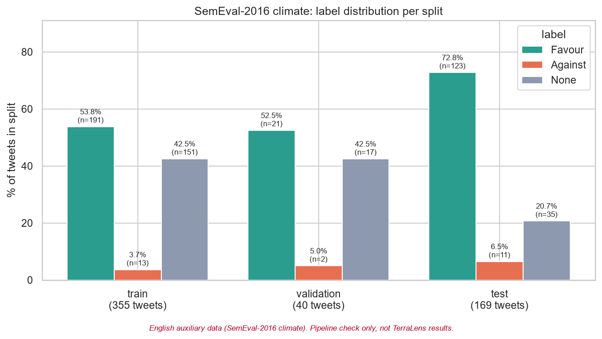
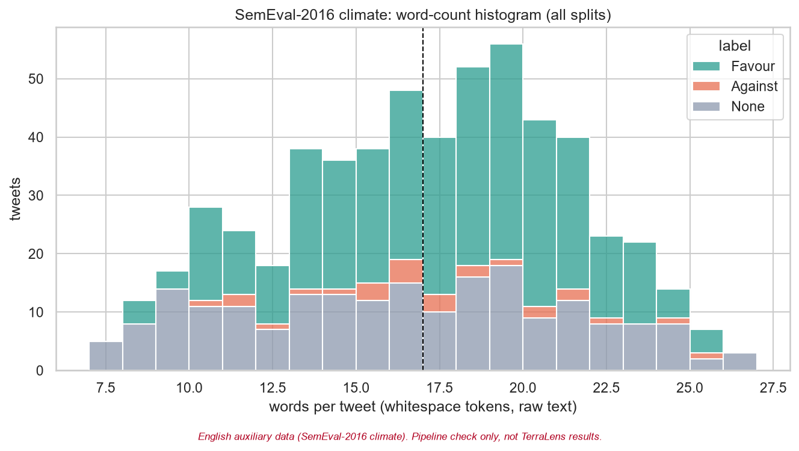
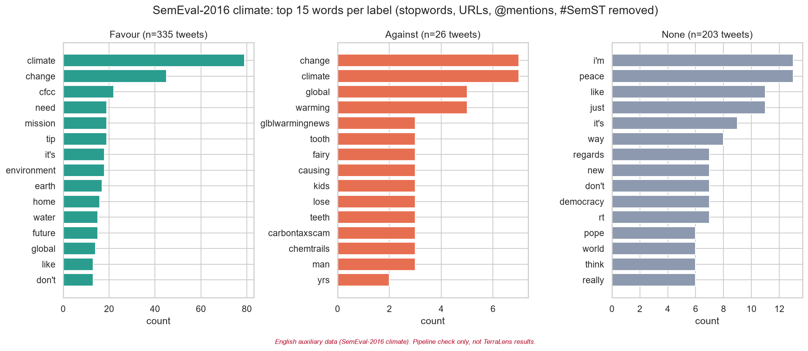
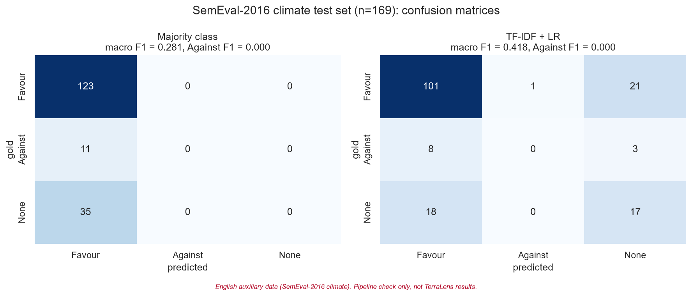
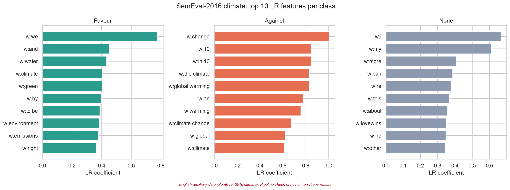

# SemEval-2016 climate: EDA and baseline summary

> **English auxiliary data (SemEval-2016 climate). Pipeline check only, not TerraLens results.**
> These are English tweets used as auxiliary data. Nothing here measures performance on the Hindi/Bengali
> TerraLens task. Generated by `notebooks/01_eda_semeval.ipynb`.

## Data

`data/external/semeval_climate.csv`: 564 English tweets on the target *"Climate Change is a Real Concern"*
(SemEval-2016 Task 6, via `cardiffnlp/tweet_eval` `stance_climate`).

| split | Favour | Against | None | total |
|---|---|---|---|---|
| train | 191 | 13 | 151 | 355 |
| validation | 21 | 2 | 17 | 40 |
| test | 123 | 11 | 35 | 169 |
| total | 335 | 26 | 203 | 564 |

- **Against is tiny**: 26 tweets overall (4.6%),
  and only 11 in test, so Against-class metrics on this set are very noisy.
- Tweets are short: median 17 words, mean 16.6.

| label | count | mean | median | min | max |
|---|---|---|---|---|---|
| Favour | 335 | 17.01 | 17.0 | 8 | 25 |
| Against | 26 | 16.88 | 16.5 | 10 | 25 |
| None | 203 | 15.88 | 16.0 | 7 | 27 |

**Noise.** 564 tweets (100.0%) carry the `#SemST`
collection tag; 71.3% have another hashtag,
40.2% an @mention, 0.0% a URL and
0.0% an emoji. The `tweet_eval` release is already pre-processed: user handles are
masked as `@user`, and URLs and emojis were stripped upstream, so the URL/emoji cleaning steps are not exercised here
(the YouTube comments will need them).

**Top words** (stopwords, URLs, @mentions, `#SemST` removed):

- Favour: climate (79), change (45), cfcc (22), need (19), mission (19), tip (19), it's (18), environment (18), earth (17), home (16)
- Against: change (7), climate (7), global (5), warming (5), glblwarmingnews (3), tooth (3), fairy (3), causing (3), kids (3), lose (3)
- None: i'm (13), peace (13), like (11), just (11), it's (9), way (8), regards (7), new (7), don't (7), democracy (7)

## Baseline (train+validation → test)

TF-IDF word 1-2-grams + char_wb 2-5-grams (`FeatureUnion`, `min_df=2`, sublinear TF) + `LogisticRegression(class_weight="balanced", max_iter=1000)`,
compared with a majority-class (`Favour`) baseline. Trained on 395 tweets, evaluated once on 169 test tweets.

| model | accuracy | macro_f1 | against_f1 |
|---|---|---|---|
| Majority class | 0.728 | 0.281 | 0.0 |
| TF-IDF + LR | 0.698 | 0.418 | 0.0 |

TF-IDF + LR per-class results on test:

| class | precision | recall | f1-score | support |
|---|---|---|---|---|
| Favour | 0.795 | 0.821 | 0.808 | 123 |
| Against | 0.0 | 0.0 | 0.0 | 11 |
| None | 0.415 | 0.486 | 0.447 | 35 |

**Against-class F1 (TF-IDF + LR): 0.000** (majority baseline: 0.000).

| gold | pred Favour | pred Against | pred None |
|---|---|---|---|
| Favour | 101 | 1 | 21 |
| Against | 8 | 0 | 3 |
| None | 18 | 0 | 17 |

Top LR features per class:

- Favour: w:we, w:and, w:water, w:climate, w:green, w:by, w:to be, w:environment, w:emissions, w:right
- Against: w:change, w:10, w:in 10, w:the climate, w:global warming, w:an, w:warming, w:climate change, w:global, w:climate
- None: w:i, w:my, w:more, w:can, w:re, w:this, w:about, w:lovewins, w:he, w:other

## Takeaways

- The EDA → preprocessing → TF-IDF → LR → evaluation pipeline runs end to end and the figures and metrics are produced
  in the format planned for the official data.
- LR beats the majority baseline on macro F1 (0.418 vs 0.281).
- Against F1 is 0.000: LR predicted Against 1 time(s) and recovered
  0 of 11 gold Against tweets. With only
  15 Against tweets in training, class weighting alone is not enough, and with
  11 in test a single prediction moves Against F1 a lot.
  SemEval climate is too small and too imbalanced to say much about the Against class; GWSD (400 Against) is the better
  English source for that.

*English auxiliary data (SemEval-2016 climate). Pipeline check only, not TerraLens results.*
