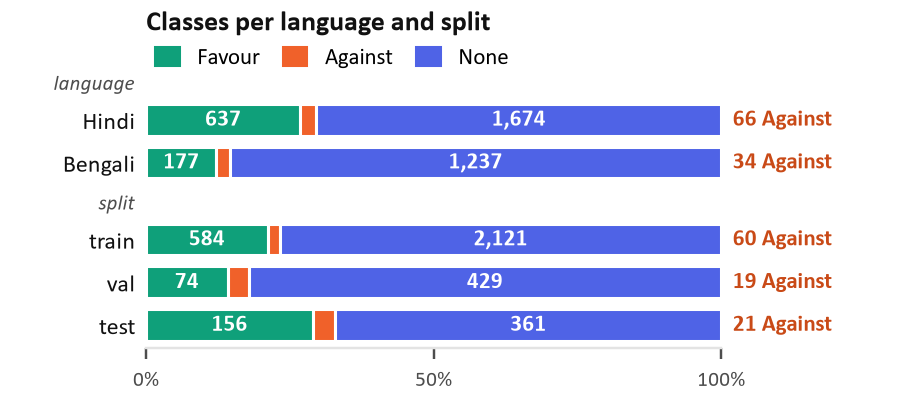
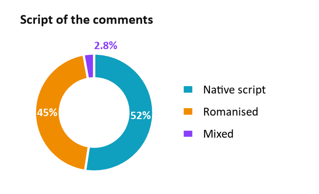
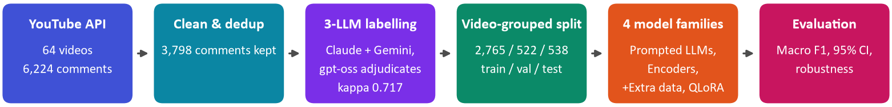
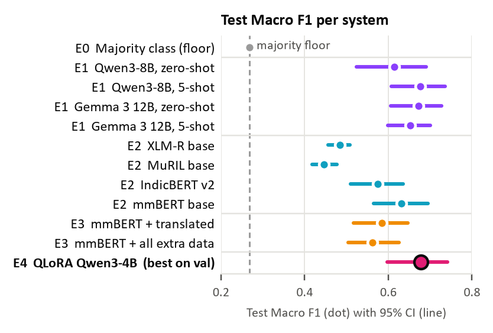
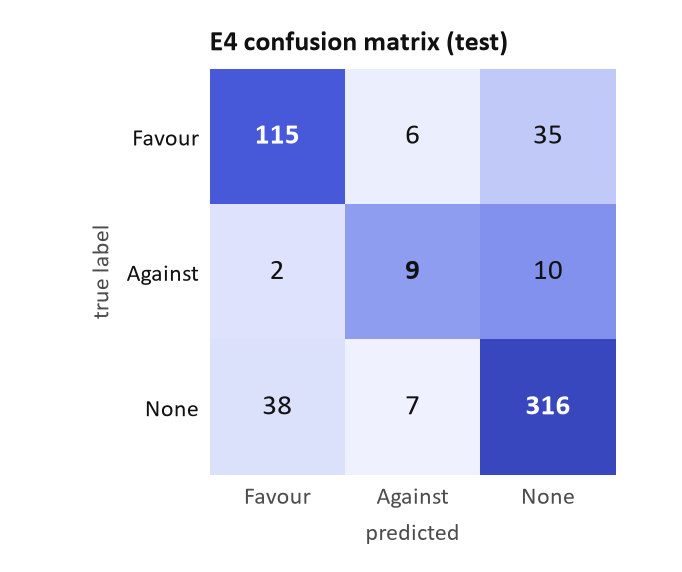
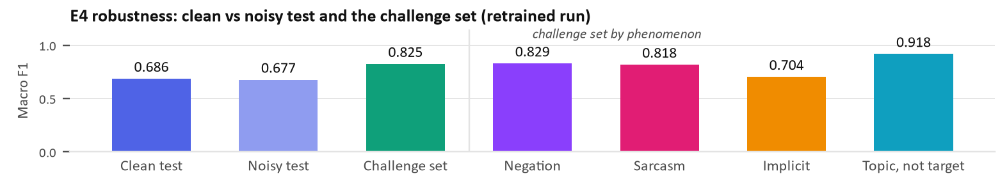

# TerraLens: Stance Detection on Climate Change in Hindi & Bengali YouTube Comments

Shaurya Nigam (S24CSEU0497) · Nakshatra Bhateja (S24CSEU1245) · GitHub: [https://github.com/shaauryaa/terralens](https://github.com/shaauryaa/terralens)

CSET 346 Natural Language Processing · Round 2 Progress Report

<!-- Every number below comes from results/*.json, reports/results.md or reports/dataset_stats.md.
     The PDF is built from this file by scripts/build_report.py; figures by scripts/make_report_figures.py. -->

## 1. Dataset

Task: label a comment's stance toward *"Climate change and global warming is a serious concern"* as **Favour**,
**Against** or **None**. We use **real YouTube comments** because they match the hidden test set: native-script,
romanised (Latin letters) and code-mixed (with English) text.

We collected **6,224 comments from 64 Hindi and Bengali climate videos**. After cleaning and labelling, the dataset has
**3,825 comments: 814 Favour, 100 Against, 2,911 None** (Hindi 2,377, Bengali 1,448). **1,710** comments are
romanised and **109** mixed-script.

The split is **grouped by video**, so all comments of a video stay in one split and a model cannot memorise a
video's topic: **train 2,765 / validation 522 / test 538** comments from 43 / 11 / 10 videos.

 

*Figure 1. Against is the smallest class in every language and split; about half of the comments are not in native script.*

Two LLMs (**Claude**, **Gemini**) labelled every comment independently using a **10-rule guideline**, and
**gpt-oss-120b** settled their disagreements; agreement is **88.7% (Cohen's kappa 0.717)**, and **31** unresolved
comments were dropped. On human-labelled data, including Hindi translations, the annotators reach **Macro F1 0.64–0.71**.

## 2. Methodology & implementation

*Figure 2. Pipeline. Extra data (translated, romanised, synthetic) is train only; validation and test are real comments only.*

| Model family | What it is | Why we chose it |
|---|---|---|
| **E0** Majority | Always predicts None | The floor every model must beat |
| **E1** Prompted LLMs | Qwen3-8B, Gemma 3 12B; zero- and 5-shot | No training; tests general LLMs |
| **E2** Encoders | XLM-R, MuRIL, IndicBERT v2, mmBERT | Fast; multilingual, Indic and newest models |
| **E3** Encoder + data | mmBERT + translated, romanised, synthetic | Does more non-YouTube data help? |
| **E4** QLoRA | Qwen3-4B, adapters on a 4-bit model | LLM knowledge + our labels; fits one T4 |

All trained models use **class-weighted cross-entropy** (mistakes on rare classes cost more). Epochs, thresholds and
the best model are chosen on **validation only**; test is scored once.

**Implementation:** Python package + **24 scripts**, **12 YAML configs** (11 experiments + YouTube search), **Kaggle T4
GPU**, one JSON result per run, tables and figures built from those files, **221 automated tests**.

## 3. Results & analysis

**11 systems** compared across **4 model families**. **Best system (chosen on validation): QLoRA Qwen3-4B, test Macro F1
0.678, 2.5× the majority floor (0.268).**

**Macro F1** runs from 0 to 1 and averages the F1 of the three classes, so a model only scores high if it also finds the
rare Against comments; the range in brackets is the **95% confidence interval**.

| Exp | System | Val Macro F1 | Test Macro F1 [95% CI] | Test Against F1 |
|---|---|---:|---:|---:|
| E0 | Majority class (floor) | 0.301 | 0.268 [0.258, 0.277] | 0.000 |
| E1 | Gemma 3 12B, zero-shot (best E1 on validation) | 0.583 | 0.672 [0.606, 0.728] | 0.423 |
| E2 | XLM-R base | 0.471 | 0.484 [0.456, 0.508] | 0.000 |
| E2 | MuRIL base | 0.512 | 0.446 [0.417, 0.477] | 0.000 |
| E2 | IndicBERT v2 | 0.605 | 0.574 [0.510, 0.636] | 0.238 |
| E2 | mmBERT base | 0.661 | 0.631 [0.564, 0.695] | 0.318 |
| E3 | mmBERT + all extra data (best E3) | 0.674 | 0.561 [0.504, 0.626] | 0.143 |
| **E4** | **QLoRA Qwen3-4B** | **0.687** | **0.678 [0.598, 0.742]** | **0.419** |

 

*Figure 3. Left: every model beats the floor, and the LLM-based systems are highest. Right: most E4 errors confuse Favour and None.*

- **Newest models win.** **mmBERT**, the newest encoder, is the best encoder; **XLM-R** and **MuRIL** never predict Against.
- **LLMs are best overall.** **E4** leads on validation and test; **three of the four prompted LLMs** beat every encoder
  on test without any training, but not on validation.
- **Extra data helped validation, not test.** For mmBERT (mean of 3 seeds), validation rose from **0.628 to 0.665**
  but test fell from **0.630 to 0.587**: translated tweets, news and Reddit text differ from YouTube comments.
- **Error analysis:** most E4 errors are **Favour vs None** (35 and 38 test comments); among **40 validation errors**
  grouped by cause (from English glosses), the most common are **blame/politics talk**, **comments about climate
  without a stance**, and **generic agreement with the video**.
- **Robustness:** a retrained E4 run loses little on a **noisy copy of test** (typos, transliteration) and does well
  on **217 generated hard comments** (Figure 4).

*Figure 4. Noise costs E4 little; implicit stance is the hardest challenge slice.*

## 4. Challenges

| Challenge | What we did |
|---|---|
| **Against is rare** in every split | Class-weighted loss; Against F1 always reported with its 95% CI; 177 synthetic Against comments added to training |
| **Labelling 3,825 comments** in two languages without native-speaker annotators | A written guideline, two independent LLM annotators and an adjudicator; agreement and a human gold check measured; unresolved comments dropped |
| **Romanised and mixed-script** text with noisy spelling | Multilingual encoders and LLMs; romanised training copies; a noisy test copy to check robustness |

## 5. Future work before the final evaluation

- A **native-speaker check of 150 labels** to measure label noise.
- **XLM-R large** and more encoder tuning (learning rate, epochs) to close the gap to E4.
- An **ensemble** of QLoRA, the best encoder and the best prompted LLM.
- **Saved models** with a `predict` command that writes the prediction file for the hidden test set.
- **5-fold video-grouped cross-validation** for model selection, since a validation set with 19 Against comments
  makes selection noisy.

## 6. Team contributions

| Member | Contribution |
|---|---|
| **Shaurya Nigam** (S24CSEU0497) | Data collection, labelling pipeline, model implementation and training, evaluation, report |
| **Nakshatra Bhateja** (S24CSEU1245) | Data collection, dataset and model research, report |

---

Tools and data used: YouTube Data API v3 · Hugging Face Transformers and PEFT · IndicTrans2 · scikit-learn ·
Kaggle (T4 GPU) · English stance data for translation: SemEval-2016, GWSD, ClimateStance, Kaggle Twitter climate
sentiment.
